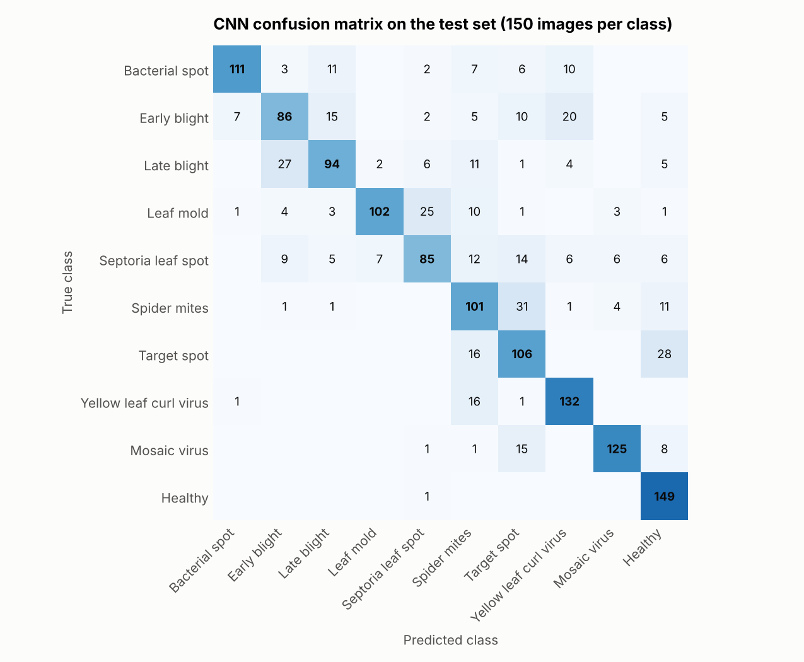

# Tomato Leaf Disease Classification with a CNN

Image classifier that recognises 10 classes of tomato leaf (nine diseases plus healthy), built in Google Colab for my MSc Data Analytics (BSBI, Berlin).

**Result:** the CNN reaches **72.7 % accuracy** (macro F1 0.73) on 1,500 held-out test images after 5 epochs of training. Random guessing would give 10 %.

## What's inside

- `tomato_disease_cnn.ipynb`: the full notebook, with outputs
- `confusion_matrix.png`: test-set confusion matrix of the CNN

## Data

10,000 tomato leaf images in 10 balanced classes (1,000 each), with PlantVillage class labels. I split them into:

| Set | Images | Use |
|-----|--------|-----|
| Training | 6,800 | fitting the model, with augmentation (rotation, shift, shear, zoom, flip) |
| Validation | 1,700 | monitoring during training |
| Test | 1,500 (150 per class) | final evaluation only |

The images are not included in this repository.

## What I did

1. Explored the data: class balance, image sizes, sample images per class
2. Held out 15 % of each class as a test set before training
3. Built a CNN in Keras: three Conv2D + MaxPooling blocks (32, 64, 128 filters), a 512-unit dense layer with dropout, and a softmax output. Images are resized to 150×150.
4. Trained for 5 epochs with Adam, early stopping and model checkpointing
5. Trained a fully connected network without convolutions as a baseline
6. Evaluated both on the test set with accuracy, precision, recall, F1, a confusion matrix and ROC curves

## Results

| Model | Test accuracy | Macro F1 |
|-------|---------------|----------|
| CNN | 72.7 % | 0.73 |
| Fully connected baseline | 10.0 % | 0.02 |

The baseline did not learn: it predicts the same class for every image, which is exactly chance level. The comparison shows how much the convolutional layers matter for image data.



Per-class results of the CNN:

| Class | Precision | Recall | F1 |
|-------|-----------|--------|----|
| Bacterial spot | 0.93 | 0.74 | 0.82 |
| Early blight | 0.66 | 0.57 | 0.61 |
| Late blight | 0.73 | 0.63 | 0.67 |
| Leaf mold | 0.92 | 0.68 | 0.78 |
| Septoria leaf spot | 0.70 | 0.57 | 0.62 |
| Spider mites | 0.56 | 0.67 | 0.61 |
| Target spot | 0.57 | 0.71 | 0.63 |
| Yellow leaf curl virus | 0.76 | 0.88 | 0.82 |
| Mosaic virus | 0.91 | 0.83 | 0.87 |
| Healthy | 0.70 | 0.99 | 0.82 |

What the errors show:

- **Healthy leaves are almost never missed** (149 of 150 found), but the model is too quick to call a leaf healthy: 28 target spot and 11 spider mite images were labelled healthy. In practice that is the costly kind of error, because a diseased plant goes untreated.
- **Spider mites and target spot are confused with each other** (31 and 16 images).
- **Early and late blight are confused with each other** (27 and 15 images).

## Known issue in the notebook

The class names printed in the notebook's classification report, confusion matrix and sample predictions are in the wrong order. The notebook takes the names from the folder listing, while Keras numbers the classes alphabetically. The overall accuracy and F1 are not affected. The table and confusion matrix in this README use the correct alphabetical order. The fix is one line before the evaluation cells:

```python
class_names = list(test_generator.class_indices.keys())
```

## Limitations and next steps

- 5 epochs is short; validation accuracy was still moving, so longer training would probably help.
- A pretrained network (for example EfficientNet) with transfer learning is the standard way to get well above 90 % on this kind of data.
- The fully connected baseline needs a lower learning rate or normalisation to be a fair comparison.

## How to run

Open the notebook in Google Colab, upload the dataset as `Datasetplant.zip` (with a `tomato/train` folder containing one subfolder per class), and run the cells in order.

**Tools:** Python, TensorFlow/Keras, scikit-learn, Matplotlib, Seaborn, Google Colab
